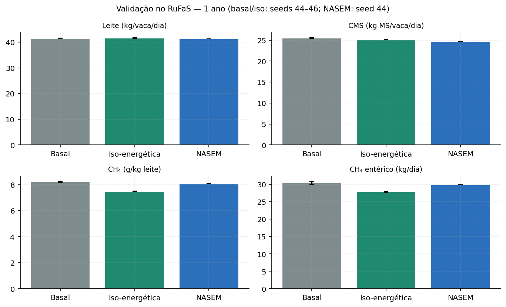
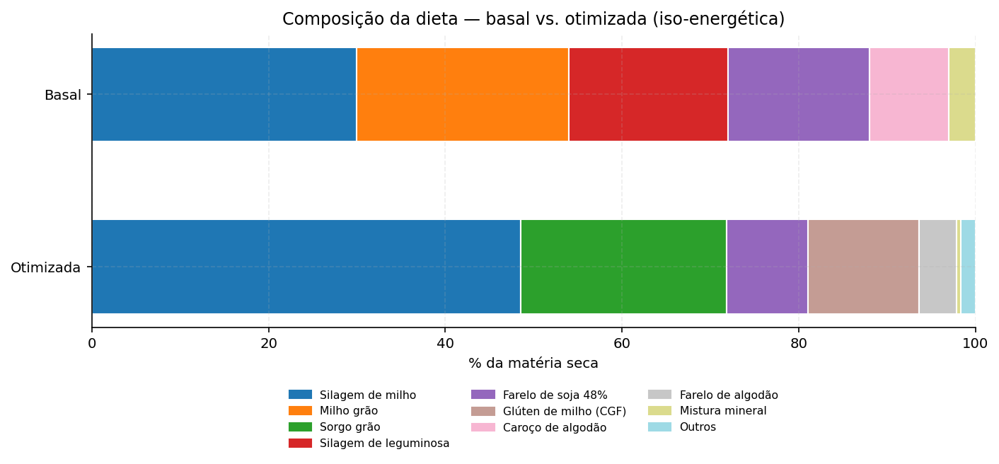
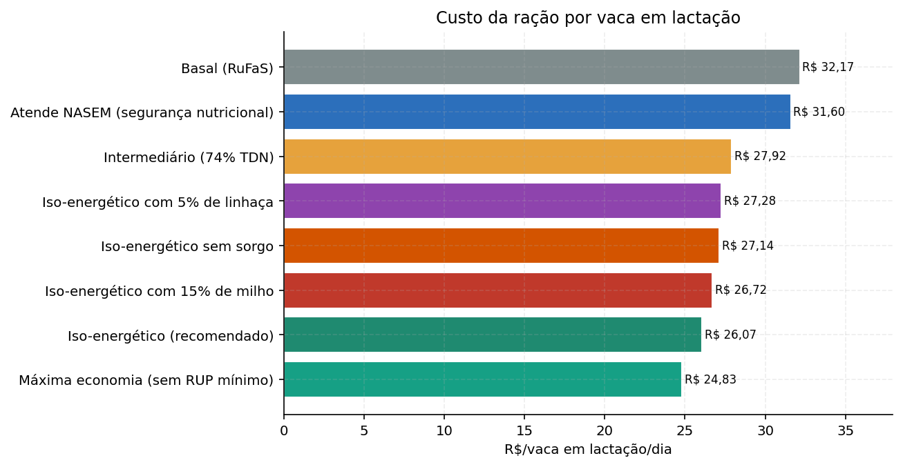
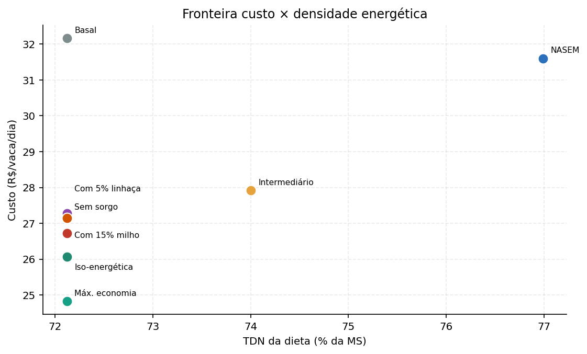
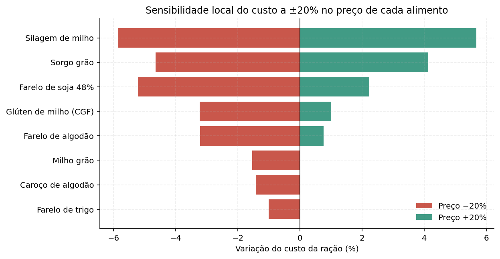
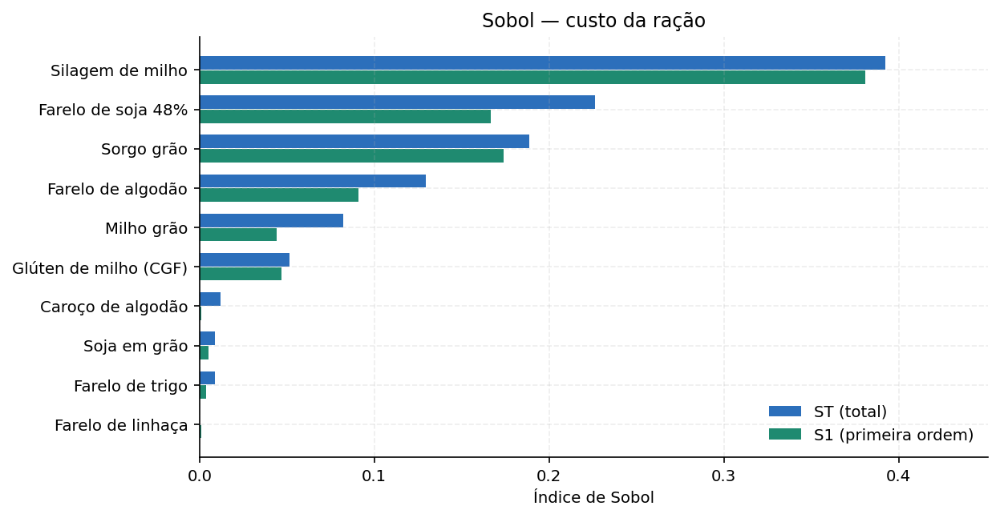
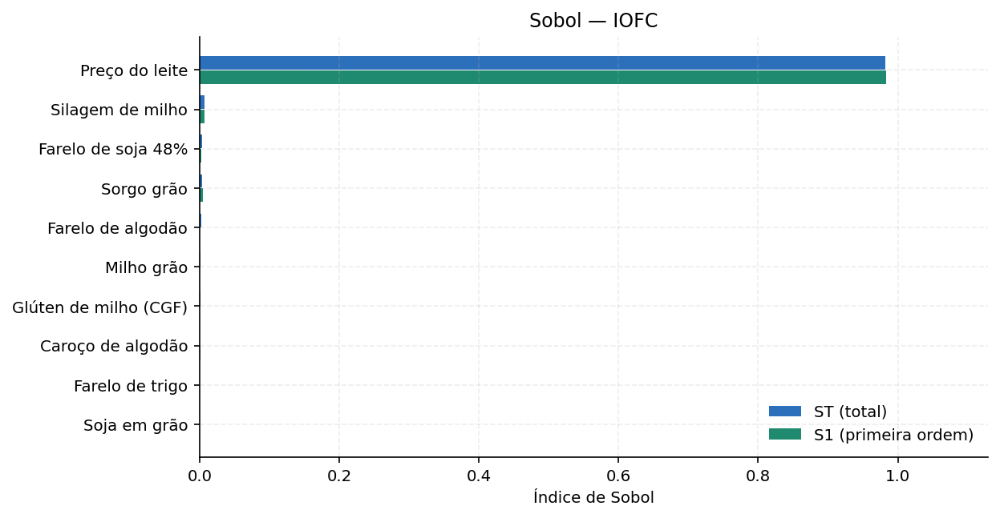
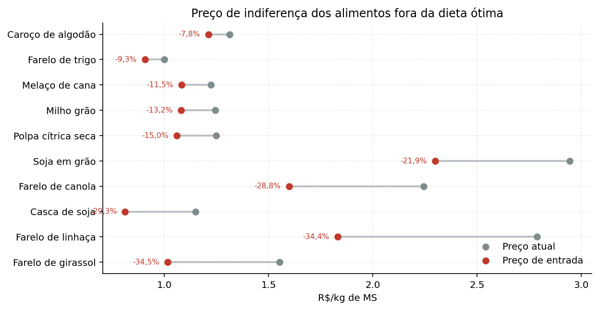

# Otimização da dieta e efeito econômico — Fazenda Campo Dourado (GO)

**Data:** 2026-10-27  
**Autor:** Análise integrada ao RuFaS  
**Fazenda:** Fazenda Campo Dourado (GO)  
**Modelo:** RuFaS 1.0.5 + módulo de otimização linear

## 1. Resumo executivo

Este trabalho desenvolve um módulo de **programação linear (PL)** acoplado aos arquivos de entrada e saída do **RuFaS** para formular a dieta da vaca em lactação da Fazenda Campo Dourado (GO) ao **mínimo custo**, com avaliação do efeito econômico, análise de sensibilidade local e global (Sobol) e validação biológica no simulador.

**Resultado principal.** A dieta iso-energética (mesmo aporte de energia, proteína e fibra da dieta basal) custa **R$ 26,07/vaca/dia**, contra **R$ 32,17/vaca/dia** da dieta basal avaliada com os mesmos preços de GO. Isso representa economia de **R$ 6,10/vaca/dia (19,0%)** e **R$ 197.199,00/ano** para as 88,56 vacas em lactação. A margem sobre o custo da ração (IOFC) sobe 7,0%.

**Dieta recomendada (iso-energética):** Silagem de milho 48,6%, Sorgo grão 23,2%, Glúten de milho (CGF) 12,6%, Farelo de soja 48% 9,2%, Farelo de algodão 4,3%, completando com minerais e ureia. A formulação substitui parte do milho e do farelo de soja por **sorgo, glúten de milho e farelo de algodão**, além de trocar a mistura mineral de 3% por calcário + mistura mineral em nível menor.

**Custo de segurança nutricional.** Se a fazenda quiser corrigir o déficit teórico de energia da dieta basal e atender à exigência NASEM (TDN 76,99% da MS), o custo sobe para **R$ 31,60/vaca/dia** — ainda 1,8% abaixo da basal, mas com economia muito menor. O cenário iso-energético é o de maior retorno econômico; o cenário NASEM é o mais conservador.

**Decomposição da economia.** Cerca de **60,7%** da economia vêm da substituição de fontes minerais caras (3% de mistura mineral) por calcário e por fósforo de alimentos como farelo de algodão e glúten de milho; os outros **39,3%** vêm da reformulação dos demais ingredientes. Esse ponto é importante: parte do ganho é correção de uma fórmula mineral possivelmente superdimensionada no cenário basal, não só “troca de milho por sorgo”. A decomposição é contábil: parte do fósforo foi transferida para farelo de algodão e glúten de milho, cujo custo aparece nas outras linhas; o ganho líquido é a diferença total.

**Sensibilidade.** O custo da ração é dominado pelo preço da **silagem de milho** (ST ≈ 0,39), seguido por **farelo de soja** (ST ≈ 0,23) e **sorgo** (ST ≈ 0,19). Na margem (IOFC), o **preço do leite** domina (ST ≈ 0,98); os preços dos alimentos têm efeito pequeno. O milho grão só entra na dieta se cair cerca de **13,2%**; o farelo de linhaça, se cair cerca de **34,4%**.

Na validação de 1 ano no RuFaS (seeds 44–46), a produção de leite do lote ficou em 3.720 kg/dia com a dieta otimizada contra 3.707 kg/dia da basal; o CMS caiu 1,2% e a intensidade de metano entérico caiu 8,8%.

> **Leitura crítica:** o módulo é uma aproximação linear do modelo NASEM. Ele não substitui o RuFaS; serve para explorar o espaço de formulação, gerar hipóteses e orientar negociação de preços. A decisão final deve ser validada com o simulador completo (`full_farm`), com a dieta real da fazenda e com acompanhamento de consumo, leite, escore corporal e saúde ruminal.


## 2. Contexto e problema

O RuFaS é um simulador *whole-farm* de fazendas leiteiras. O cenário `GO_campo_dourado` representa uma fazenda de 100 vacas Holstein em Goiás, com 88,6 vacas em lactação em média, produção de 41,3 kg de leite/vaca/dia e consumo de 25,3 kg de MS/vaca/dia. A dieta basal do RuFaS é definida no arquivo `feed.json` e inclui silagem de milho, silagem de leguminosa, milho grão, farelo de soja, caroço de algodão e mistura mineral.

O problema de pesquisa operacional é:

> Dado um lote de vacas com exigências nutricionais conhecidas, um conjunto de alimentos com composição e preço, e limites práticos de inclusão, qual mistura de alimentos atende às exigências ao **menor custo**? Como o custo e a composição ótima reagem a mudanças de preço? A dieta ótima mantém a produção quando simulada no RuFaS?

O escopo é a **ração da vaca em lactação** (pen `LAC_COW_PEN_3`), não o rebanho total. Bezerras, novilhas e vacas secas têm outras dietas e não são otimizadas aqui. O custo é o da ração no cocho, sem armazenamento, perdas, mistura, mão de obra ou capital.

**Dados de preço.** Preços de milho, soja e leite vêm do CEPEA (27/10/2026 para grãos; leite GO de ago/2026). Farelo de soja em Anápolis/GO vem da Agrolink (27/10/2026). Subprodutos sem indicador público usam cotação regional ou estimativa declarada. O câmbio usado para converter os preços do RuFaS é R$ 5,35/US$ (Notícias Agrícolas, 27/10/2026).

**Hipótese central.** A dieta basal foi formulada com preços e ingredientes do exemplo do RuFaS (Nordeste dos EUA). Ao reavaliar a mesma dieta com preços de Goiás e permitir outros ingredientes, existe espaço para reduzir custo sem piorar o aporte nutricional.


## 3. Dados e método

### 3.1 Exigências nutricionais

As exigências foram calculadas com o próprio calculador NASEM do RuFaS para uma vaca de 650 kg, 150 dias em lactação, 41,3 kg de leite/dia, 4,0% de gordura e 3,2% de proteína:

| Indicador | Valor |
|---|---:|
| Consumo de MS (DMI) | 25,30 kg/dia |
| Energia líquida de lactação (NEl) | 44,69 Mcal/dia |
| Proteína metabolizável (PM) | 2.557 g/dia |
| Cálcio absorvível | 66,8 g/dia |
| Fósforo absorvível | 64,1 g/dia |
| TDN mínimo equivalente | 76,99% da MS |

Além das exigências NASEM, foram impostas restrições práticas de formulação: NDF entre 28,00% e 33,00%, NDF de forragem ≥ 18,00%, amido entre 25,00% e 35,00%, extrato etéreo entre 3,00% e 6,00%, proteína bruta ≥ 17,50%, RUP digestível ≥ 1,20 kg/dia, cálcio total ≥ 0,60% e relação Ca:P entre 1,50 e 2,50. O cálcio e o fósforo absorvíveis usam os fatores de digestibilidade do RuFaS (0,30 para forragem, 0,60 para concentrado e 0,95 para mineral).

### 3.2 Formulação do problema de programação linear

Variáveis de decisão: $x_i$ = kg de MS/dia do alimento $i$ (19 alimentos candidatos).

```
minimizar   Σ c_i x_i
sujeito a   Σ x_i = 25,3                     (consumo de MS)
            Σ a_ij x_i ≥ b_j                 (nutrientes mínimos)
            Σ a_ij x_i ≤ b_j                 (limites máximos)
            l_i ≤ x_i ≤ u_i                  (inclusão mínima e máxima)
```

O problema tem 19 variáveis e 37 restrições de desigualdade, além da igualdade de MS. Foi resolvido com `scipy.optimize.linprog`, método **dual simplex** (HiGHS). O quadro final do simplex foi reconstruído a partir da base ótima para leitura econômica (custos reduzidos e preços sombra).

### 3.3 Dieta basal e cenários

A dieta basal é a ração `lac_cow` do `feed.json` do RuFaS, com 30% de silagem de milho, 18% de silagem de leguminosa, 24% de milho, 16% de farelo de soja, 9% de caroço de algodão e 3% de mistura mineral. Ela foi avaliada com a mesma tabela de preços da otimização, para separar efeito de formulação de efeito de preço.

Cenários:
- **Iso-energético (recomendado):** TDN mínimo igual ao da dieta basal (72,12% da MS), mantendo energia, proteína e fibra.
- **NASEM:** TDN mínimo de 76,99% da MS, corrigindo o déficit teórico de energia; NDF mínimo de 27,5% e Ca:P mínimo de 1,2 para acomodar a alta densidade energética.
- **Intermediário:** TDN de 74,0%.
- **Com milho 15%:** força pelo menos 15% de milho grão.
- **Com linhaça 5%:** força 5% de farelo de linhaça.
- **Sem sorgo:** simula indisponibilidade de sorgo.
- **Máxima economia:** remove a exigência de RUP e reduz a proteína bruta para 17,0%.

### 3.4 Análise de sensibilidade

- **Local:** preço sombra de cada restrição, custo reduzido de cada alimento, faixas de RHS que preservam a base ótima e preço de indiferença dos alimentos.
- **Global (Sobol):** 10 preços de alimentos variando ±30% e preço do leite ±20%; índices de primeira ordem (S1) e total (ST), com 512 amostras e *bootstrap* de 100 reamostragens.
- **Testes pareados:** os mesmos choques de preço são aplicados a todos os cenários; as diferenças são comparadas com Wilcoxon e IC bootstrap de 95%.
- **Pairwise de ingredientes:** para pares como milho × sorgo, calcula-se o preço de indiferença do segundo ingrediente.

### 3.5 Validação no RuFaS

A dieta iso-energética foi convertida em `feed_otimizado.json` e simulada no RuFaS em modo `animals_only`, 1 ano (2015), seeds 44, 45 e 46. A basal foi simulada nas mesmas seeds; a NASEM, na seed 44. Foram comparados leite, consumo de MS, metano entérico e intensidade de metano. O modo `animals_only` isola o efeito nutricional; não inclui dejetos, solo, culturas nem custos completos da fazenda.


## 4. Resultados

### 4.1 Dieta ótima

A dieta iso-energética de mínimo custo é:

| Alimento | % MS | kg MS/dia | R$/kg MS | R$/dia |
|---|---|---|---|---|
| Silagem de milho | 48,6% | 12,29 | R$ 0,62 | R$ 7,65 |
| Sorgo grão | 23,2% | 5,88 | R$ 1,01 | R$ 5,95 |
| Glúten de milho (CGF) | 12,6% | 3,18 | R$ 1,23 | R$ 3,92 |
| Farelo de soja 48% | 9,2% | 2,34 | R$ 2,26 | R$ 5,29 |
| Farelo de algodão | 4,3% | 1,08 | R$ 2,00 | R$ 2,16 |
| Calcário calcítico | 1,2% | 0,32 | R$ 0,30 | R$ 0,09 |
| Mistura mineral | 0,5% | 0,13 | R$ 6,00 | R$ 0,76 |
| Ureia pecuária | 0,4% | 0,10 | R$ 2,53 | R$ 0,25 |

A dieta basal, para comparação, é:

| Alimento | % MS | kg MS/dia | R$/kg MS | R$/dia |
|---|---|---|---|---|
| Silagem de milho | 30,0% | 7,59 | R$ 0,62 | R$ 4,72 |
| Milho grão | 24,0% | 6,07 | R$ 1,24 | R$ 7,55 |
| Silagem de leguminosa | 18,0% | 4,55 | R$ 0,70 | R$ 3,19 |
| Farelo de soja 48% | 16,0% | 4,05 | R$ 2,26 | R$ 9,16 |
| Caroço de algodão | 9,0% | 2,28 | R$ 1,31 | R$ 2,99 |
| Mistura mineral | 3,0% | 0,76 | R$ 6,00 | R$ 4,55 |

Observações:
- A otimização **não usa milho grão** no cenário iso-energético: o sorgo e o glúten de milho entregam TDN e proteína a custo menor por unidade de energia. O milho só entra se seu preço cair (ver seção 5).
- O farelo de soja cai de 16% para cerca de 9%; parte da proteína é suprida por farelo de algodão, glúten de milho e ureia.
- A mistura mineral cai de 3% para 0,5%, com 1,2% de calcário. O fósforo é suprido por farelo de algodão e glúten de milho, que são fontes mais baratas por unidade de P.
- A dieta usa 0,4% de ureia, dentro do limite de 0,6% da MS. Ureia é uma fonte de nitrogênio não proteico; seu uso exige adaptação gradual e mistura uniforme.

### 4.2 Adequação nutricional

| Indicador | Basal | Iso-energética | NASEM | Requisito |
|---|---|---|---|---|
| Proteína bruta (% MS) | 18,56 | 17,50 | 17,82 | 17,50 |
| NDF (% MS) | 28,72 | 28,00 | 27,50 | 28,00 (iso) / 27,50 (NASEM) – 33,00 |
| Amido (% MS) | 27,47 | 35,00 | 31,53 | 25,00–35,00 |
| Extrato etéreo (% MS) | 4,28 | 3,18 | 4,79 | 3,00–6,00 |
| TDN (% MS) | 72,12 | 72,12 | 76,99 | 72,12 (iso) / 76,99 (NASEM) |
| NEl (Mcal/dia) | 41,67 | 41,67 | 44,69 | 41,67 (iso = basal) / 44,69 (NASEM) |
| RUP digestível (kg/dia) | 1,20 | 1,20 | 1,20 | 1,20 |
| Ca absorvível (g/dia) | 147,14 | 144,11 | 109,83 | 66,76 |
| P absorvível (g/dia) | 64,51 | 64,06 | 64,06 | 64,06 |

A dieta iso-energética atende às restrições impostas. O TDN é igual ao da basal (72,12%), o que é coerente com a hipótese de manter a produção. A dieta NASEM eleva o TDN para 76,99%, mas custa mais. O cálcio absorvível da basal é cerca de 147 g/dia, muito acima dos 66,8 g/dia exigidos; a dieta otimizada mantém cerca de 144 g/dia, porque o mínimo de cálcio total (0,60%) e a relação Ca:P mínima (1,5) impedem uma redução maior. Se o objetivo fosse reduzir o excesso de cálcio, seria necessário relaxar essas restrições e buscar outra fonte de fósforo; o ganho econômico e ambiental não foi incluído nesta análise.

### 4.3 Efeito econômico

| Indicador | Basal | Iso-energética | NASEM |
|---|---|---|---|
| Custo da ração (R$/vaca/dia) | R$ 32,17 | R$ 26,07 | R$ 31,60 |
| Custo por kg de leite (R$/kg) | R$ 0,779 | R$ 0,631 | R$ 0,765 |
| IOFC (R$/vaca/dia) | R$ 86,89 | R$ 92,99 | R$ 87,45 |
| Custo da ração (% da receita) | 27,0% | 21,9% | 26,5% |
| Economia anual (R$) | — | R$ 197.199 | R$ 18.206 |

O custo da ração da vaca em lactação cai de **R$ 32,17** para **R$ 26,07/dia**, uma economia de **19,0%**. Para 88,6 vacas, isso equivale a **R$ 197.199,00/ano**. A margem sobre o custo da ração sobe de R$ 86,89 para R$ 92,99/vaca/dia (+7,0%). O custo da ração como proporção da receita cai de 27,0% para 21,9%.

### 4.4 Comparação de cenários

| Cenário | R$/vaca/dia | R$/kg leite | Economia vs. basal | IOFC (R$/vaca/dia) | Economia anual (R$) |
|---|---|---|---|---|---|
| Basal (RuFaS) | R$ 32,17 | R$ 0,78 | 0,0% | R$ 86,89 | R$ 0 |
| Iso-energético (recomendado) | R$ 26,07 | R$ 0,63 | +19,0% | R$ 92,99 | R$ 197.199 |
| Atende NASEM (segurança nutricional) | R$ 31,60 | R$ 0,77 | +1,8% | R$ 87,45 | R$ 18.206 |
| Intermediário (74% TDN) | R$ 27,92 | R$ 0,68 | +13,2% | R$ 91,13 | R$ 137.173 |
| Iso-energético com 15% de milho | R$ 26,72 | R$ 0,65 | +16,9% | R$ 92,34 | R$ 176.169 |
| Iso-energético com 5% de linhaça | R$ 27,28 | R$ 0,66 | +15,2% | R$ 91,77 | R$ 157.845 |
| Iso-energético sem sorgo | R$ 27,14 | R$ 0,66 | +15,6% | R$ 91,91 | R$ 162.382 |
| Máxima economia (sem RUP mínimo) | R$ 24,83 | R$ 0,60 | +22,8% | R$ 94,23 | R$ 237.224 |

O cenário de **máxima economia** chega a R$ 24,83/vaca/dia, mas remove a exigência de RUP e reduz a proteína bruta; é um limite superior teórico, não uma recomendação direta. O cenário **com milho 15%** custa R$ 26,72/vaca/dia (+2,5% vs. iso), mostrando o custo de manter o milho por razões operacionais. O cenário **com linhaça 5%** custa R$ 27,28/vaca/dia; o prêmio sobre a iso é de R$ 1,22/vaca/dia.

### 4.5 Validação biológica no RuFaS

| Cenário | Seed | Leite (kg/dia) | Vacas | Leite/vaca (kg/dia) | CMS (kg/vaca/dia) | CH₄ (kg/dia) | CH₄ (g/kg leite) |
|---|---|---|---|---|---|---|---|
| Basal (RuFaS) | 44 | 3.657 | 88,56 | 41,29 | 25,39 | 29,98 | 8,20 |
| Basal (RuFaS) | 45 | 3.726 | 89,70 | 41,54 | 25,47 | 30,45 | 8,17 |
| Basal (RuFaS) | 46 | 3.738 | 90,50 | 41,30 | 25,57 | 30,79 | 8,24 |
| Iso-energético (recomendado) | 44 | 3.715 | 89,20 | 41,65 | 25,11 | 27,80 | 7,48 |
| Iso-energético (recomendado) | 45 | 3.710 | 89,65 | 41,38 | 25,11 | 27,64 | 7,45 |
| Iso-energético (recomendado) | 46 | 3.734 | 89,67 | 41,64 | 25,28 | 28,02 | 7,50 |
| Atende NASEM (segurança nutricional) | 44 | 3.697 | 89,38 | 41,37 | 24,71 | 29,84 | 8,07 |

A validação é exploratória: 1 ano, sem repetição de curto prazo. Basal e iso-energética foram simuladas com 3 seeds; a NASEM, com 1 seed (44). Os efeitos de metano da iso são consistentes em sinal e magnitude, mas o teste de Wilcoxon com 3 seeds tem baixo poder estatístico (p = 0,25). O leite ficou estável; o CMS caiu levemente; o metano entérico por kg de leite caiu cerca de 9%.











## 5. Análise de sensibilidade

### 5.1 Preços sombra e quadro final do simplex

O quadro final do simplex mostra quais restrições estão ativas e quanto custaria apertá-las ou relaxá-las. A tabela abaixo traz as restrições com folga zero; o preço sombra é o acréscimo de custo (R$/vaca/dia) para **aumentar em uma unidade** a exigência (ou o valor de **relaxar** o limite, no caso de restrições de máximo).

| Restrição ativa | Valor atual | Mínimo | Máximo | Preço sombra (R$/dia) | Unidade |
|---|---|---|---|---|---|
| Proteína não degradável digestível mínima | 1,20 | 1,13 | 1,20 | R$ 6,407 | kg |
| Inclusão mínima — Mistura mineral | 0,13 | 0,00 | 0,13 | R$ 6,052 | kg MS |
| Energia (TDN) mínima | 72,12 | 71,69 | 72,12 | R$ 0,625 | p.p. |
| Proteína bruta mínima | 17,50 | 16,48 | 17,53 | R$ 0,150 | p.p. |
| Amido máximo | 35,00 | 33,28 | 35,01 | R$ 0,078 | p.p. |
| Fósforo absorvível mínimo | 64,06 | 62,08 | 64,21 | R$ 0,027 | g |

Leitura de negócio:
- **Energia (TDN):** cada ponto percentual adicional de TDN custa cerca de R$ 0,625/vaca/dia. Isso mostra o custo de buscar uma dieta mais energética.
- **Proteína bruta:** cada ponto percentual adicional custa cerca de R$ 0,150/vaca/dia.
- **RUP:** cada kg adicional de RUP digestível custa cerca de R$ 6,407/vaca/dia; é a restrição mais cara da formulação.
- **Mistura mineral:** o mínimo de 0,5% custa cerca de R$ 6,052/vaca/dia por kg adicional de MS. Isso reforça que a mistura mineral é um item de alto custo unitário.

As faixas de RHS mostram até onde a base ótima não muda. Por exemplo, a exigência de TDN pode cair de 72,12% até 71,69% sem trocar a base; acima disso, a composição muda.

### 5.2 Preço de indiferença dos alimentos

A tabela abaixo mostra quanto cada alimento **fora da dieta** precisaria cair para entrar na solução ótima:

| Alimento | Preço atual (R$/kg MS) | Preço de entrada (R$/kg MS) | Redução necessária |
|---|---|---|---|
| Farelo de girassol | R$ 1,55 | R$ 1,02 | -34,5% |
| Farelo de linhaça | R$ 2,79 | R$ 1,83 | -34,4% |
| Casca de soja | R$ 1,15 | R$ 0,81 | -29,3% |
| Farelo de canola | R$ 2,24 | R$ 1,60 | -28,8% |
| Soja em grão | R$ 2,94 | R$ 2,30 | -21,9% |
| Polpa cítrica seca | R$ 1,25 | R$ 1,06 | -15,0% |
| Milho grão | R$ 1,24 | R$ 1,08 | -13,2% |
| Melaço de cana | R$ 1,22 | R$ 1,08 | -11,5% |
| Farelo de trigo | R$ 1,00 | R$ 0,91 | -9,3% |
| Caroço de algodão | R$ 1,31 | R$ 1,21 | -7,8% |
| Silagem de leguminosa | R$ 0,70 | R$ 0,67 | -3,9% |

E quanto cada alimento **na dieta** pode subir antes de ser substituído:

| Alimento na dieta | Preço atual (R$/kg MS) | Preço de saída (R$/kg MS) | Aumento suportado |
|---|---|---|---|
| Silagem de milho | R$ 0,62 | R$ 0,64 | +3,0% |
| Farelo de algodão | R$ 2,00 | R$ 2,07 | +3,3% |
| Farelo de soja 48% | R$ 2,26 | R$ 2,41 | +6,4% |
| Glúten de milho (CGF) | R$ 1,23 | R$ 1,31 | +6,4% |
| Sorgo grão | R$ 1,01 | R$ 1,18 | +17,0% |
| Ureia pecuária | R$ 2,53 | R$ 3,37 | +33,4% |
| Calcário calcítico | R$ 0,30 | R$ 1,34 | +345,6% |
| Mistura mineral | R$ 6,00 | ∞ | ∞ |

O caso do **milho** é o mais didático: aos preços de 27/10/2026 (R$ 64,87/saca), ele não entra. O preço de indiferença é cerca de **R$ 1,08/kg MS**, equivalente a uma queda de **13,2%** (cerca de R$ 56/saca). A **linhaça** só entra se cair **34,4%**, para cerca de R$ 1,83/kg MS. O preço de referência é o Indicador CEPEA Campinas; para uma fazenda em Goiás, o preço posto na fazenda pode ser diferente. O critério prático é: **se o milho posto estiver abaixo de ~R$ 56/saca, ele passa a competir**; acima disso, o sorgo tende a dominar.

### 5.3 Comparações pareadas de ingredientes

| Alimento A | Alimento B | Preço atual de B (R$/kg MS) | Preço de indiferença de B (R$/kg MS) | Variação de B |
|---|---|---|---|---|
| Milho grão | Sorgo grão | R$ 1,01 | R$ 1,18 | +17,0% |
| Farelo de soja 48% | Farelo de algodão | R$ 2,00 | R$ 2,07 | +3,3% |
| Farelo de soja 48% | Soja em grão | R$ 2,94 | R$ 2,30 | -21,9% |
| Silagem de milho | Silagem de leguminosa | R$ 0,70 | R$ 0,67 | -3,9% |
| Farelo de soja 48% | Farelo de linhaça | R$ 2,79 | R$ 1,83 | -34,4% |
| Glúten de milho (CGF) | Farelo de trigo | R$ 1,00 | R$ 0,91 | -9,3% |

Exemplo: o sorgo pode subir cerca de **+17,0%** antes de o milho assumir seu espaço. O farelo de algodão pode subir cerca de **+3,3%** antes de o farelo de soja voltar. O farelo de linhaça precisaria cair **34,4%** para competir com o farelo de soja.

### 5.4 Sensibilidade local (tornado)

| Alimento | Custo −20% | Custo +20% | Amplitude (R$/dia) |
|---|---|---|---|
| Silagem de milho | -5,9% | +5,7% | R$ 3,01 |
| Sorgo grão | -4,7% | +4,1% | R$ 2,29 |
| Farelo de soja 48% | -5,2% | +2,2% | R$ 1,94 |
| Glúten de milho (CGF) | -3,2% | +1,0% | R$ 1,11 |
| Farelo de algodão | -3,2% | +0,8% | R$ 1,04 |
| Milho grão | -1,5% | 0,0% | R$ 0,40 |
| Caroço de algodão | -1,4% | 0,0% | R$ 0,37 |
| Farelo de trigo | -1,0% | 0,0% | R$ 0,26 |
| Soja em grão | 0,0% | 0,0% | R$ 0,00 |
| Farelo de linhaça | 0,0% | 0,0% | R$ 0,00 |

A silagem de milho é o item de maior impacto: ±20% no seu preço move o custo da ração em cerca de ±5,7%. Sorgo e farelo de soja vêm em seguida. A linhaça tem impacto praticamente nulo porque não está na dieta.



### 5.5 Sensibilidade global (Sobol)

**Custo da ração.** Índices de Sobol para os 10 preços de alimentos variando ±30%:

| Alimento | S1 | IC 95% | ST | IC 95% |
|---|---|---|---|---|
| Silagem de milho | 0,381 | 0,068 | 0,392 | 0,052 |
| Farelo de soja 48% | 0,167 | 0,057 | 0,226 | 0,041 |
| Sorgo grão | 0,174 | 0,043 | 0,189 | 0,030 |
| Farelo de algodão | 0,091 | 0,046 | 0,129 | 0,025 |
| Milho grão | 0,044 | 0,035 | 0,082 | 0,022 |
| Glúten de milho (CGF) | 0,047 | 0,029 | 0,051 | 0,009 |
| Caroço de algodão | 0,001 | 0,012 | 0,012 | 0,003 |
| Soja em grão | 0,005 | 0,013 | 0,009 | 0,003 |
| Farelo de trigo | 0,004 | 0,012 | 0,009 | 0,002 |
| Farelo de linhaça | 0,001 | 0,001 | 0,000 | 0,000 |

**Margem sobre o custo da ração (IOFC).** Inclui o preço do leite variando ±20%:

| Variável | S1 | IC 95% | ST | IC 95% |
|---|---|---|---|---|
| Preço do leite | 0,984 | 0,100 | 0,982 | 0,092 |
| Silagem de milho | 0,007 | 0,011 | 0,007 | 0,001 |
| Farelo de soja 48% | 0,002 | 0,008 | 0,004 | 0,001 |
| Sorgo grão | 0,004 | 0,007 | 0,003 | 0,000 |
| Farelo de algodão | 0,000 | 0,006 | 0,002 | 0,000 |
| Milho grão | -0,000 | 0,004 | 0,001 | 0,000 |
| Glúten de milho (CGF) | 0,001 | 0,003 | 0,001 | 0,000 |
| Caroço de algodão | 0,001 | 0,002 | 0,000 | 0,000 |
| Farelo de trigo | -0,000 | 0,002 | 0,000 | 0,000 |
| Soja em grão | -0,000 | 0,002 | 0,000 | 0,000 |

Interpretação:
- No custo, a **silagem de milho** é o fator dominante (ST ≈ 0,39), seguida de **farelo de soja** (ST ≈ 0,23) e **sorgo** (ST ≈ 0,19). A linhaça tem ST ≈ 0,0000, praticamente zero.
- No IOFC, o **preço do leite** explica cerca de 98,2% da variância; os preços dos alimentos somam pouco. A mensagem de gestão é clara: **negociar leite e manter a produção** importa mais do que perseguir o último centavo na ração; a ração é alavanca de custo, mas o preço do leite é a alavanca de receita.





### 5.6 Testes pareados de cenários

| Cenário A | Cenário B | Δ médio (R$/dia) | Δ (%) | IC 95% inf. | IC 95% sup. | p (Wilcoxon) |
|---|---|---|---|---|---|---|
| Iso-energético (recomendado) | Atende NASEM (segurança nutricional) | R$ 5,94 | +23,3% | R$ 5,80 | R$ 6,08 | 0,0000 |
| Iso-energético (recomendado) | Intermediário (74% TDN) | R$ 1,79 | +7,0% | R$ 1,73 | R$ 1,86 | 0,0000 |
| Iso-energético (recomendado) | Iso-energético com 15% de milho | R$ 0,73 | +2,9% | R$ 0,65 | R$ 0,80 | 0,0000 |
| Iso-energético (recomendado) | Iso-energético com 5% de linhaça | R$ 1,30 | +5,1% | R$ 1,25 | R$ 1,36 | 0,0000 |
| Iso-energético (recomendado) | Iso-energético sem sorgo | R$ 0,98 | +3,9% | R$ 0,89 | R$ 1,08 | 0,0000 |
| Iso-energético (recomendado) | Máxima economia (sem RUP mínimo) | R$ -1,51 | -5,9% | R$ -1,58 | R$ -1,44 | 0,0000 |

Todos os cenários foram resolvidos sobre a mesma amostra de 256 choques de preço (±20%), o que controla o efeito comum de mercado. As diferenças são estatisticamente significativas. O cenário iso-energético é mais barato que o NASEM, o intermediário, o com milho, o com linhaça e o sem sorgo; o cenário de máxima economia é ainda mais barato, mas com risco nutricional.




## 6. Integração com o RuFaS

O módulo gera os seguintes arquivos para rodar a dieta no RuFaS:

| Arquivo | Uso |
|---|---|
| `feed_otimizado.json` | Cópia do `feed.json` com a ração `lac_cow` substituída pela dieta ótima e os novos alimentos adicionados ao bloco `feeds`. |
| `config_otimizado.json` | Configuração de validação (`animals_only`, 1 ano) ou de simulação completa. |
| `farm_metadata_otimizado.json` | Metadata da fazenda apontando para o feed e a config otimizados. |
| `_otimizacao_tasks.json` | Task de execução com seed e prefixo de saída. |
| `_otimizacao_task_manager_metadata.json` | Wrapper para rodar com `main.py -p`. |
| `dieta_iso.csv`, `dieta_nasem.csv`, `quadro_simplex.csv` | Tabelas de apoio. |

Comando de validação (1 ano, `animals_only`):

```powershell
.\.venv\Scripts\python.exe main.py -p .\GO_campo_dourado\otimizacao_dieta\_otimizacao_task_manager_metadata.json -v errors
```

Para simulação completa de 5 anos (`full_farm`), troque `config_otimizado.json` pelo `config.json` original e ajuste `simulation_type` para `full_farm`. O CSV de saída pode passar de 500 MB.

**Validação realizada.** A dieta iso-energética foi simulada em 1 ano com seeds 44, 45 e 46. O leite ficou em média em 3.720 kg/dia contra 3.707 kg/dia da basal (+0,3%); o CMS por vaca caiu 1,2% e a intensidade de metano entérico caiu 8,8%. A dieta NASEM (mais energética) também manteve o leite e reduziu levemente a intensidade de metano (-1,6% vs. basal no seed 44), mas custa cerca de R$ 5,53/vaca/dia mais que a iso-energética. O trade-off principal é econômico, não ambiental.

**Ressalva importante.** O RuFaS usa uma curva de lactação e um otimizador não linear internos. A dieta do módulo é imposta como ração definida pelo usuário (`user_input`), e o RuFaS verifica se ela atende às exigências. Se não atender, o modelo pode reduzir a produção. Nesta validação, o leite ficou estável, o que é um bom sinal, mas não prova que a dieta funcionará em qualquer fazenda.


## 7. Limitações e riscos

1. **Linearização.** O modelo NASEM é não linear: a energia metabolizável depende do consumo, do amido, do metano e do nitrogênio; a proteína metabolizável depende das frações de nitrogênio e da digestibilidade. O PL usa TDN, PB e RUP digestível como proxies lineares. A validação no RuFaS é a ponte entre a aproximação e o modelo completo.
2. **Preços.** Os preços são uma fotografia de 27/10/2026. Subprodutos como sorgo, glúten de milho, farelo de algodão e linhaça usam cotação regional ou estimativa; a incerteza é maior que a do milho e da soja. O preço do leite é de ago/2026 e varia por qualidade, volume e contrato.
3. **Mistura mineral.** A dieta basal usa 3% de mistura mineral, o que pode não refletir a prática da fazenda. Cerca de 61% da economia vem da troca dessa fonte mineral; se a fazenda já usa uma mistura mais barata ou parcialmente produzida na fazenda, a economia será menor. O cenário “basal ajustado” (1% mineral + 1% calcário) custa R$ 29,52/vaca/dia, mas fica deficiente em P absorvível; não é um comparativo válido sem uma fonte de fósforo.
4. **Escopo.** O custo é o da ração da vaca em lactação. Não inclui bezerras, novilhas, vacas secas, armazenamento, perdas, mistura, mão de obra, energia, capital ou custos fixos.
5. **Validação.** A validação é de 1 ano; basal e iso-energética com 3 seeds e a NASEM com 1 seed, em modo `animals_only`. O rebanho é sintético e o clima/solo são aproximações. Não houve acompanhamento de escore corporal, saúde ruminal, consumo individual ou qualidade do leite.
6. **Metano.** A dieta iso-energética reduziu o metano entérico por kg de leite na validação, mas o efeito no CO₂e total da fazenda depende de dejetos, solo, culturas e emissões de ração comprada. O modo `full_farm` é necessário para uma conclusão ambiental.
7. **Ureia.** A dieta usa 0,4% de ureia. Ureia mal misturada ou em excesso pode causar toxicidade; a adaptação deve ser gradual e acompanhada por nutricionista.
8. **Câmbio e inflação.** A conversão para US$ usa R$ 5,35/US$. Variações cambiais mudam a comparação com o RuFaS, mas não a otimização em reais.


## 8. Conclusões e recomendações

1. **A dieta iso-energética é a recomendação econômica.** Ela mantém o aporte de energia, proteína e fibra da dieta basal, custa R$ 26,07/vaca/dia contra R$ 32,17/vaca/dia da basal (19,0% de economia) e foi validada no RuFaS com leite estável. Para 88,6 vacas, a economia potencial é de R$ 197.199,00/ano.
2. **A dieta NASEM é a opção conservadora.** Atende à exigência formal de energia (TDN 76,99%) e custa R$ 31,60/vaca/dia, ainda 1,8% abaixo da basal. É indicada se a fazenda prefere segurança nutricional a economia máxima.
3. **O milho não é competitivo aos preços atuais.** Ele só entra se cair cerca de 13% (para ~R$ 56/saca). O sorgo é a principal fonte de energia da dieta ótima, seguido de glúten de milho. A fazenda deve monitorar a relação de preços milho/sorgo e contratar sorgo com antecedência.
4. **A linhaça não se paga pelo valor nutricional.** Ela só entra se cair cerca de 34%. Se a fazenda quiser leite com apelo funcional (ômega-3), o prêmio é de cerca de R$ 1,22/vaca/dia; é uma decisão de mercado, não de mínimo custo.
5. **O maior risco é o preço da silagem de milho e do farelo de soja.** A silagem de milho é o principal driver de custo (Sobol ST ≈ 0,39); o farelo de soja vem em seguida. Contratos de silagem e de farelo têm mais alavancagem que a busca por ingredientes exóticos.
6. **O preço do leite domina a margem.** No IOFC, o preço do leite explica cerca de 98,2% da variância. A gestão de receita (qualidade, volume, contrato) tem mais impacto que a otimização fina da ração.
7. **Próximos passos:** (a) rodar `full_farm` por 5 anos com a dieta iso e a basal; (b) validar com a dieta real e os preços praticados pela fazenda; (c) incluir escore corporal e saúde ruminal; (d) testar uma restrição de metano ou um preço de carbono; (e) atualizar os preços mensalmente e reotimizar; (f) negociar sorgo, glúten de milho e farelo de algodão, que são os pilares da dieta de mínimo custo.


## 8.1 Entregáveis

| Entregável | Onde está |
|---|---|
| Módulo de otimização (PL, duals, quadro simplex, Sobol, testes pareados) | `diet_optimization/` |
| Dieta integrada ao RuFaS | `GO_campo_dourado/otimizacao_dieta/feed_otimizado.json` + `farm_metadata_otimizado.json` + `_otimizacao_task_manager_metadata.json` |
| Avaliação do efeito econômico | Seção 4.3 e `cenarios.csv` |
| Análise de sensibilidade local | Seção 5.1–5.4, `faixas_rhs.csv`, `faixas_preco.csv`, `break_even.csv`, `sensibilidade_oat.csv` |
| Análise de sensibilidade global (Sobol) | Seção 5.5, `sobol_custo.csv`, `sobol_iofc.csv` |
| Testes pareados | Seção 5.6, `pairwise_cenarios.csv`, `pairwise_break_even.csv` |
| Validação biológica no RuFaS | Seção 4.5 e 6, `validacao_resumo.csv`, `validacao_testes.csv` |
| Relatório | `RELATORIO_OTIMIZACAO_DIETA.md`, `.html`, `.pdf` |
| Aula interativa | `drops_aprendizado.html` (10 drops com quiz e fazenda ilustrada) |
| Testes automatizados | `tests/test_diet_optimization/` (14 testes) |


## 9. Referências

- CEPEA/ESALQ/USP. **Indicador do milho ESALQ/BM&FBovespa** — 27/10/2026: R$ 64,87/saca de 60 kg. https://www.cepea.org.br/br/indicador/milho.aspx
- CEPEA/ESALQ/USP. **Indicador da soja CEPEA/ESALQ — Paranaguá** — 27/10/2026: R$ 157,41/saca. https://www.cepea.org.br/br/indicador/soja.aspx
- CEPEA/ESALQ/USP. **Leite ao produtor — Goiás** — ago/2026: R$ 2,9692/L. https://www.cepea.org.br/br/indicador/leite.aspx
- Agrolink. **Farelo de soja — Anápolis/GO** — 27/10/2026: R$ 2.020/t. https://www.agrolink.com.br/cotacoes/diversos/farelo-de-soja
- Notícias Agrícolas. **Farelo de soja — cotações** — 27/10/2026. https://www.noticiasagricolas.com.br/cotacoes/soja/farelo-de-soja
- Scot Consultoria / Notícias Agrícolas. **Caroço de algodão e silagem de milho** — out/2026 (cotações regionais).
- National Academies of Sciences, Engineering, and Medicine. **Nutrient Requirements of Dairy Cattle**, 8th ed., 2021.
- National Research Council. **Nutrient Requirements of Dairy Cattle**, 7th ed., 2001.
- Ruminant Farm Systems (RuFaS). **Documentação e código-fonte**, versão 1.0.5. https://github.com/RuminantFarmSystems/RuFaS
- Herman, J., Usher, W. **SALib: An open-source Python library for Sensitivity Analysis**. Journal of Open Source Software, 2017.
- Virtanen, P. et al. **SciPy 1.0: fundamental algorithms for scientific computing in Python**. Nature Methods, 2020.


## 10. Apêndice — leitura do quadro final do simplex

O quadro final completo está em `quadro_simplex.csv`. A linha `custo_reduzido` contém, para cada variável, quanto o custo aumentaria se ela fosse forçada a entrar na base. Para as variáveis fora da dieta, esse valor é o **custo reduzido**: quanto o preço do alimento precisa cair para que ele passe a ser competitivo.

As colunas de folga (`s_*`) mostram o preço sombra das restrições. Quando a folga é zero, a restrição está ativa e o preço sombra é positivo (ou negativo, dependendo do sentido). Quando a folga é positiva, a restrição não está limitando e o preço sombra é zero.

**Como ler o quadro na perspectiva do negócio:**

1. **Coluna RHS:** quantidade de cada variável básica na solução. As variáveis básicas são os alimentos que entram na dieta e as folgas das restrições não ativas.
2. **Linha de custo reduzido:** para um alimento fora da base, é o desconto de preço necessário para ele entrar. Para uma folga, é o preço sombra da restrição correspondente.
3. **Base ótima:** enquanto os preços e as exigências ficarem dentro das faixas calculadas, a composição da dieta não muda; só o custo muda. Isso dá à fazenda uma “zona de segurança” para negociar sem refazer a fórmula.
4. **Preço sombra da energia:** se o nutricionista quiser subir 1 ponto de TDN, o custo sobe aproximadamente o valor indicado. Se o ganho de leite esperado não cobrir esse custo, não vale apertar a energia.
5. **Preço sombra da RUP:** é a restrição mais cara; aumentar a proteína não degradável exige farelo de soja ou outra fonte protegida, e o custo marginal é alto.

**Observação sobre a igualdade de MS.** O dual da igualdade `soma x = DMI` não tem leitura econômica simples neste problema, porque o consumo é fixo e as exigências são proporcionais à MS. Por isso, a análise econômica foca nos preços sombra das restrições nutricionais e de inclusão, que são os instrumentos acionáveis pelo nutricionista.

### Reprodução

```powershell
# Rodar toda a análise (sem validação no RuFaS)
.\.venv\Scripts\python.exe -m diet_optimization --output-dir GO_campo_dourado/otimizacao_dieta

# Rodar com Sobol reduzido (mais rápido)
.\.venv\Scripts\python.exe -m diet_optimization --fast

# Atualizar o resumo das validações já executadas
.\.venv\Scripts\python.exe -m diet_optimization.validation --csv-dir output/CSVs
```
